# MultiPlaneDisplay

<p align="center">
  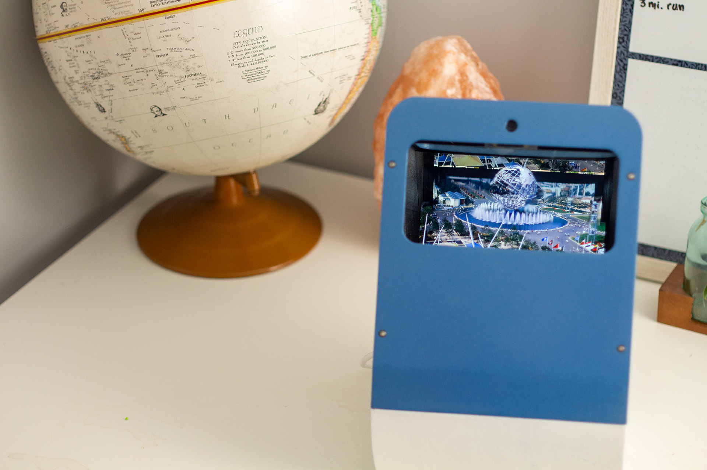
</p>

# How does it work?
Multi-Plane Display uses image processing and Pepper's Ghost illusions to enable any photo to be viewed with real depth, creating a "2 and a half D" Illusion.
<p align="center">
  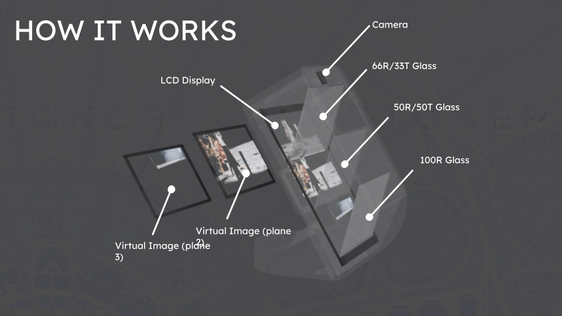
</p>

## Workflow

1. **Depth segmentation**  
   A depth map is extracted from the image using *Depth Anything v2* and used to segment the scene into **foreground**, **middleground**, and **background** layers.

2. **Viewer tracking**  
   Monocular head tracking estimates the viewer’s position relative to the display.

3. **Shadow correction**  
   Shadow maps are dynamically adjusted based on the viewer’s position to prevent off-axis ghosting artifacts.

4. **Optical display**  
   The layered images are displayed through a parascope mirror array, producing the virtual display stacking effect.
   
<table align="center">
  <tr>
    <td align="center">
      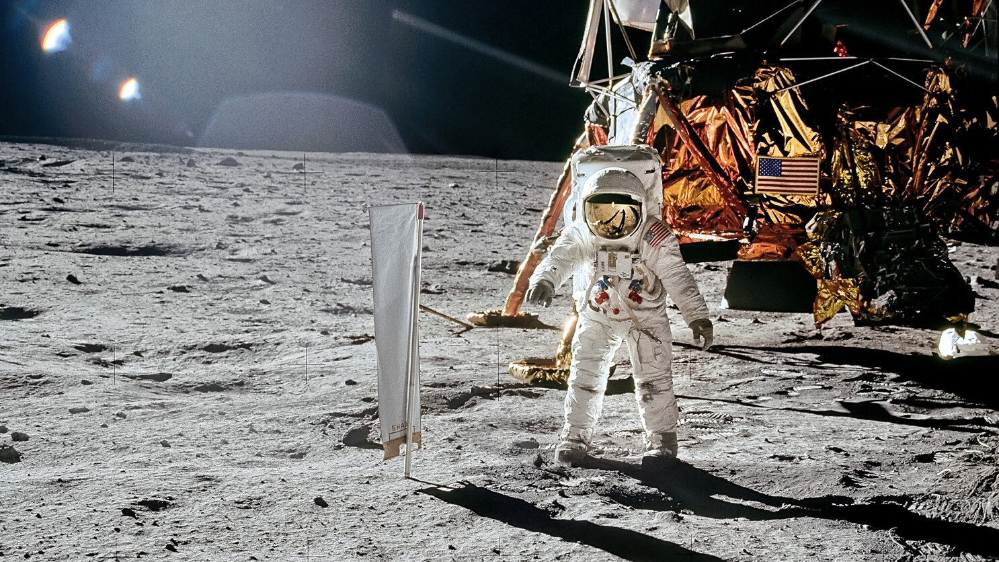<br>
      <sub>Input Image</sub>
    </td>
    <td align="center">
      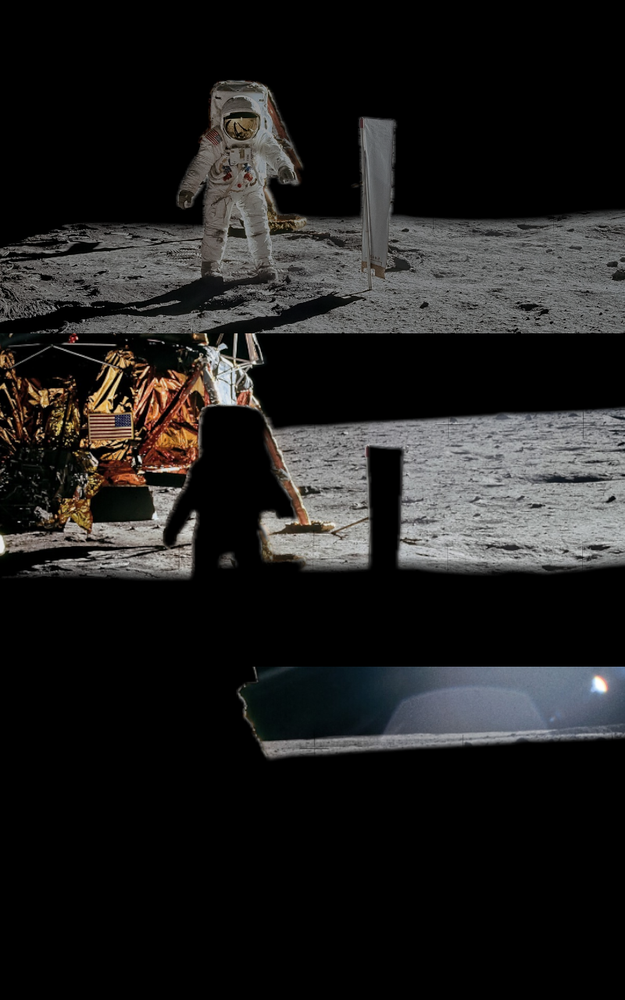<br>
      <sub>Processed Image</sub>
    </td>
    <td width="40"></td>
    <td align="center">
      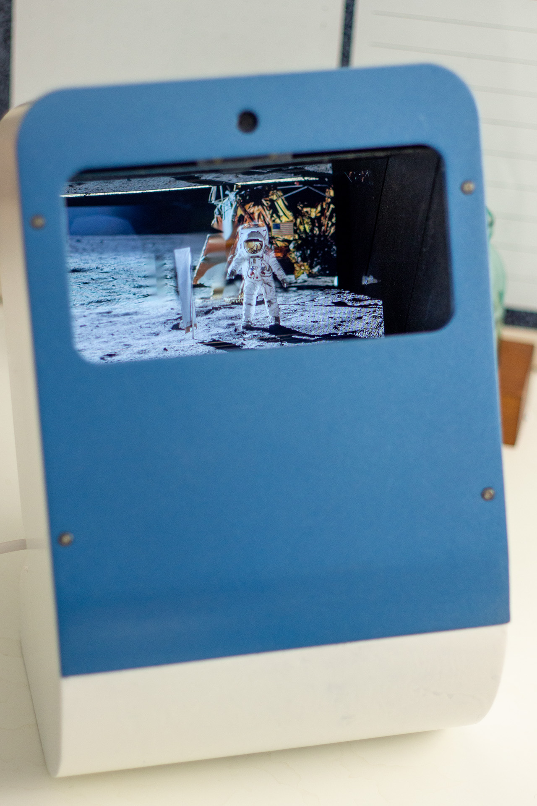<br>
      <sub>Viewable Result</sub>
    </td>
  </tr>
</table>

## Gallery
<p align="center">
  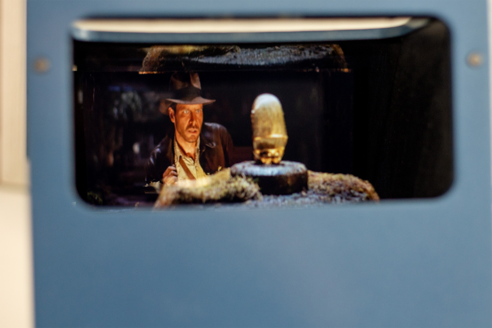
  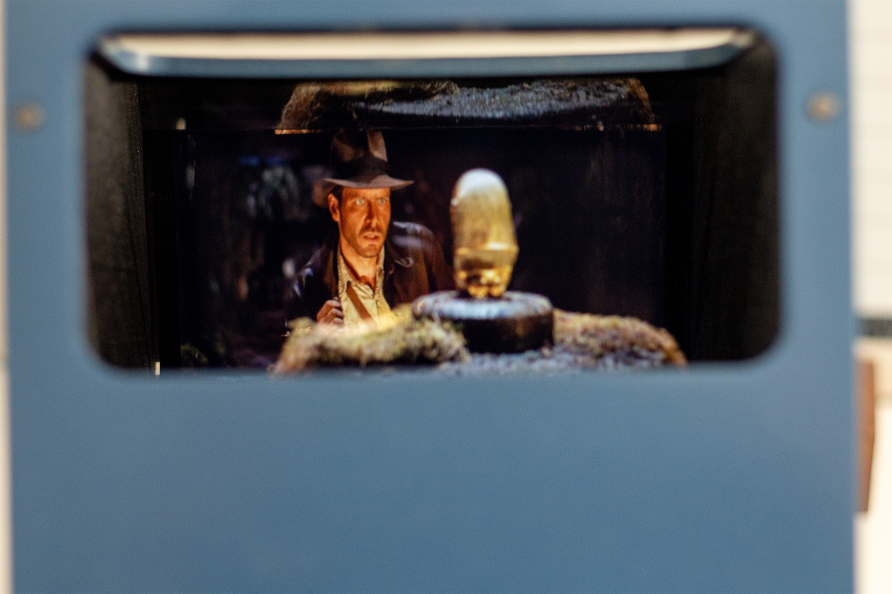
  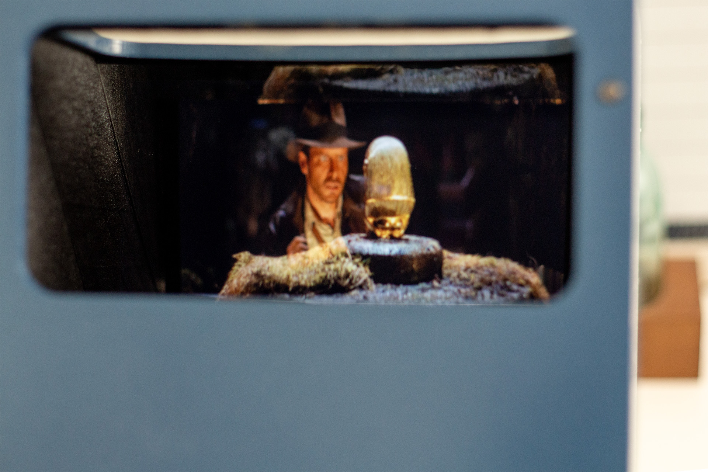
</p>

<p align="center">
  
</p>

## Features
- Automatic image processing with input from USB drive
- Image compatibility with .jpg, .jpeg, .png, .tiff, .heic/heif, and .webp formats
- 3D model compatibililty with .obj format
- Automated occlusion maps with real-time headtracking
- Automatic Display turn-off and idle mode when not being observed by a viewer

## Parts List

- Waveshare 10.1" Display  https://a.co/d/bgIxvvW
- Raspberry Pi 5  https://a.co/d/f5K5WJR
- Cooling Fan  https://a.co/d/cPdcFge
- Semi-reflective acrylic (162x110mm) (optimally use 66/33 and 50/50 teleprompter glass, but this stuff is cheap)  https://a.co/d/37wRoJS
- acrylic mirror  (162x110mm) https://a.co/d/5MYHUT7 
- 8MP camera  https://a.co/d/0b0CgG3
- RPi 5 PSU  https://a.co/d/g17dBXe
- Micro SD card  https://a.co/d/0lqvz4a
- USB Drive  https://a.co/d/dX8yHnJ
- 250 mm CSI cable  https://a.co/d/1fIMcX2

### Installation

make sure you are in your user directory (home/username)

```
git clone https://github.com/aidanmontag13/MultiPlaneDisplay3D.git
cd MultiPlaneDisplay3D
bash setup.sh
```

# Setting up the USB drive
For multiplane display, your images, 3d models, and calibration files are storred on a usb drive. This drive must be set up before running the system. Make sure the drive is formatted in the fat32 or ex-fat file system. Create a "images" folder and "models" folder in the drives root directory. Image files can be placed directly into the images folder. 3D models must be placed in a unique folder in the models folder containing the .obj, .mtl, and .jpg texture file.

Make sure to plug the usb drive into the blue usb 3.0 port on the raspberry pi.

# Calibration

Before usage, the camera intrinsics and display offset must be calibrated to display properly. This is accomplished in 2 Stages.

## Stage 1: Intrinsic Calibration
For intrinsic calibration, you must print a 9x6 checkerboard like the one at this link. Use a clipboard or book to keep the paper flat. 

<p align="center">
  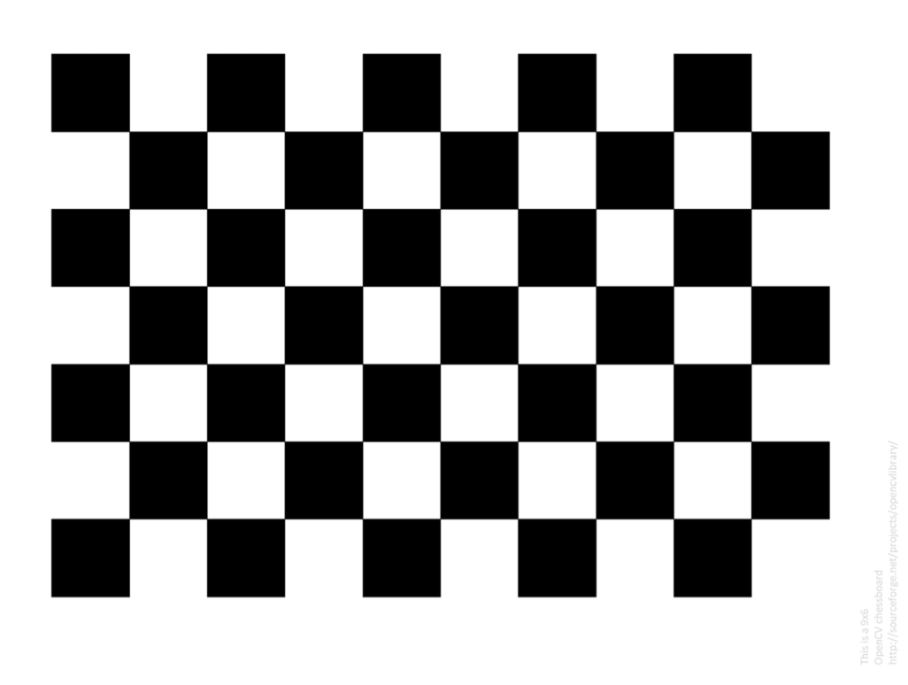
</p>

After starting your display, camera feed will pop up. Hold the checkerboard in front of the camera, and slowly move it across the frame until it fills the entire area. A visualizer will show where your checkerboard detections are, along with how dense the dectection is. Make sure to hold the board at various angles so multiple depths can be calibrated. Once every square in the visualizer turns green, calibration is complete.

<p align="center">
  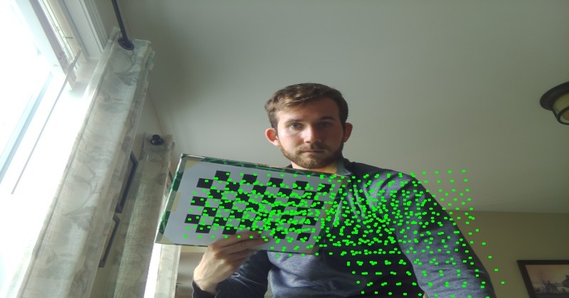
</p>

## Stage 2: Offset Calibration

Offset calibration is neccesary to estimate the distance from the camera to the center of the display. For this process, you dont need a calibration target, just your right eye!

During this step, a red, green and blue cross is projected onto each of the three displays. Close your left eye while keeping your right eye open, and aling yourself with the three crosses so all three appear overlap. This should cause the cross to appear white. Hold there, and after a few seconds, a ring will draw around the cross. Once the ring is fully drawn, calibration is complete.

The offset target will appear like this.

<p align="center">
  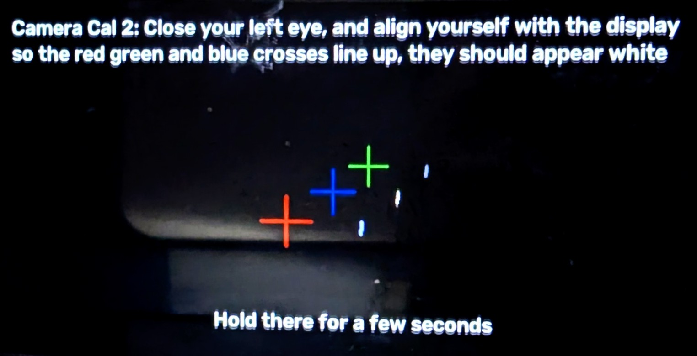
</p>

Move your head so it appears like below


<p align="center">
  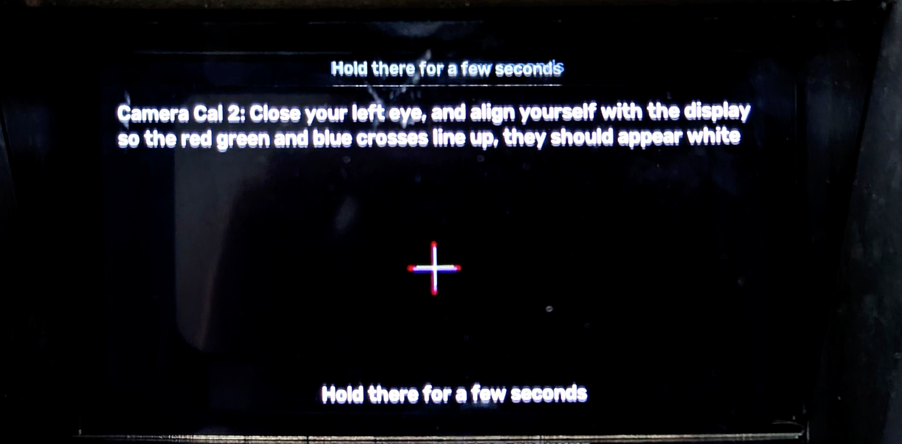
</p>


## Recalibrating
If you are unsatisfied with your calibration, you can restart the process by turning off the pi, removing the usb drive, and deleting the "camera_intrinsic_calibration.txt" and "camera_offset_calibration.txt" files. Once you plug the usb drive back in and restart the pi, the calibration prompt will come up.

