# MultiPlaneDisplay

\<p align="center">
&#x20; \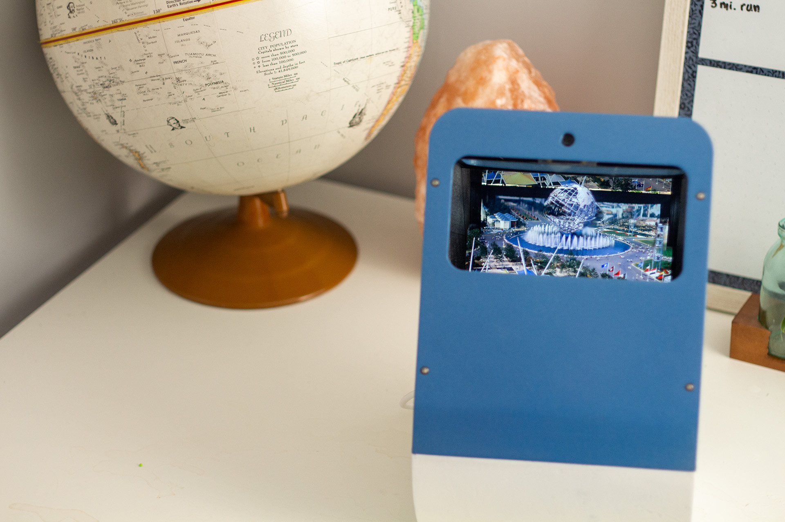
\</p>

# How does it work?

MultiPlaneDisplay uses image processing and Pepper's Ghost illusions to enable any photo to be viewed with real depth, creating a "2 and a half D" illusion.

\<p align="center">
&#x20; \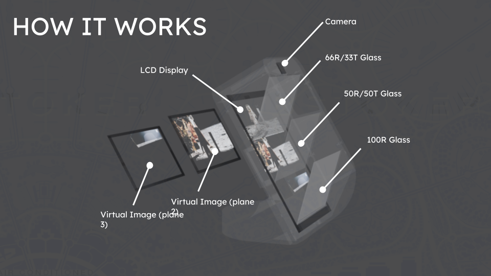
\</p>

## Workflow

1. **Depth segmentation**
   A depth map is extracted from the image using *Depth Anything V2* and used to segment the scene into **foreground**, **middleground**, and **background** layers.

2. **Viewer tracking**
   Monocular head tracking estimates the viewer's position relative to the display.

3. **Shadow correction**
   Shadow maps are dynamically adjusted based on the viewer's position to prevent off-axis ghosting artifacts.

4. **Optical display**
   The layered images are displayed through a periscope mirror array, producing the virtual display-stacking effect.

\<table align="center">
&#x20; \<tr>
&#x20;   \<td align="center">
&#x20;     \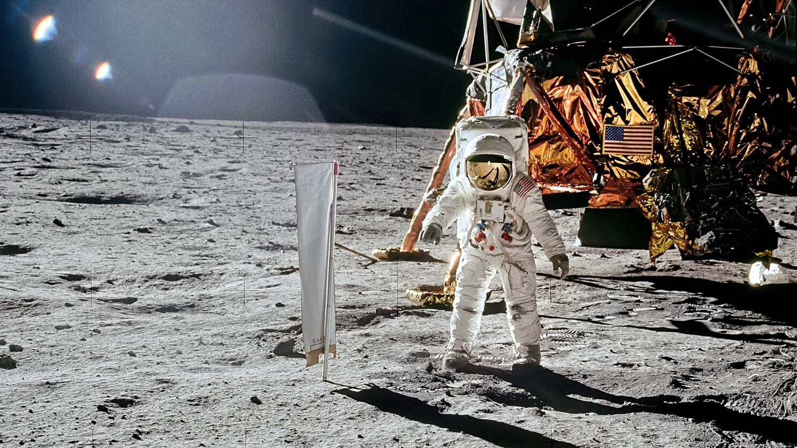\<br>
&#x20;     \<sub>Input Image\</sub>
&#x20;   \</td>
&#x20;   \<td align="center">
&#x20;     \\<br>
&#x20;     \<sub>Processed Image\</sub>
&#x20;   \</td>
&#x20;   \<td width="40">\</td>
&#x20;   \<td align="center">
&#x20;     \\<br>
&#x20;     \<sub>Viewable Result\</sub>
&#x20;   \</td>
&#x20; \</tr>
\</table>

## Gallery

\<p align="center">
&#x20; \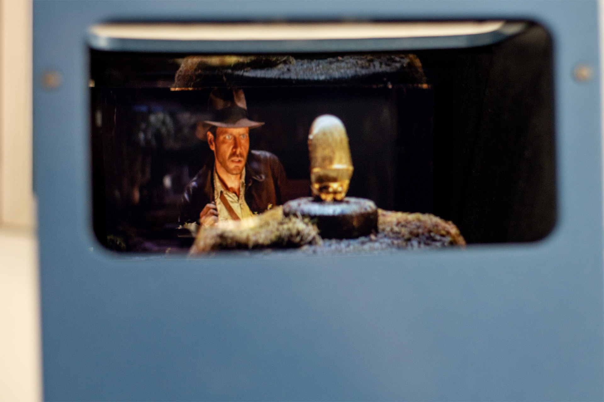
&#x20; \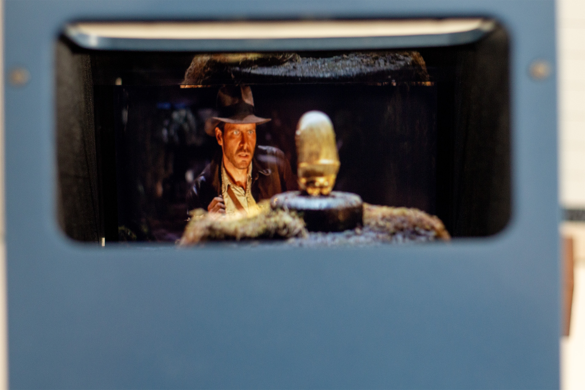
&#x20; \
\</p>

\<p align="center">
&#x20; \
\</p>

## Features

- Automatic image processing with input from a USB drive
- Image compatibility with .jpg, .jpeg, .png, .tiff, .heic/.heif, and .webp formats
- 3D model compatibility with the .obj format
- Automated occlusion maps with real-time head tracking
- Automatic display shutdown and idle mode when not being observed by a viewer

## Parts List

- Waveshare 10.1" Display [https://a.co/d/bgIxvvW](https://a.co/d/bgIxvvW)
- Raspberry Pi 5 [https://a.co/d/f5K5WJR](https://a.co/d/f5K5WJR)
- Cooling Fan [https://a.co/d/cPdcFge](https://a.co/d/cPdcFge)
- Semi-reflective acrylic (162x110mm). Ideally, use 66/33 and 50/50 teleprompter glass, but this material is inexpensive. [https://a.co/d/37wRoJS](https://a.co/d/37wRoJS)
- Acrylic mirror (162x110mm) [https://a.co/d/5MYHUT7](https://a.co/d/5MYHUT7)
- 8MP camera [https://a.co/d/0b0CgG3](https://a.co/d/0b0CgG3)
- Raspberry Pi 5 PSU [https://a.co/d/g17dBXe](https://a.co/d/g17dBXe)
- MicroSD card [https://a.co/d/0lqvz4a](https://a.co/d/0lqvz4a)
- USB drive [https://a.co/d/dX8yHnJ](https://a.co/d/dX8yHnJ)
- 250mm CSI cable [https://a.co/d/1fIMcX2](https://a.co/d/1fIMcX2)

# Construction

I recommend printing the display using black PLA, which will absorb stray light and improve display contrast. I like to sand, prime, and paint the enclosure for aesthetic purposes, but this is not necessary for the display to function. Use high-strength glue or epoxy to adhere the enclosure, base, and cap together.

Follow the cooling fan's instructions to attach it to the Raspberry Pi, then use four M2.5 screws to attach the Pi to the back of the Waveshare display.

\<p align="center">
&#x20; \
&#x20; \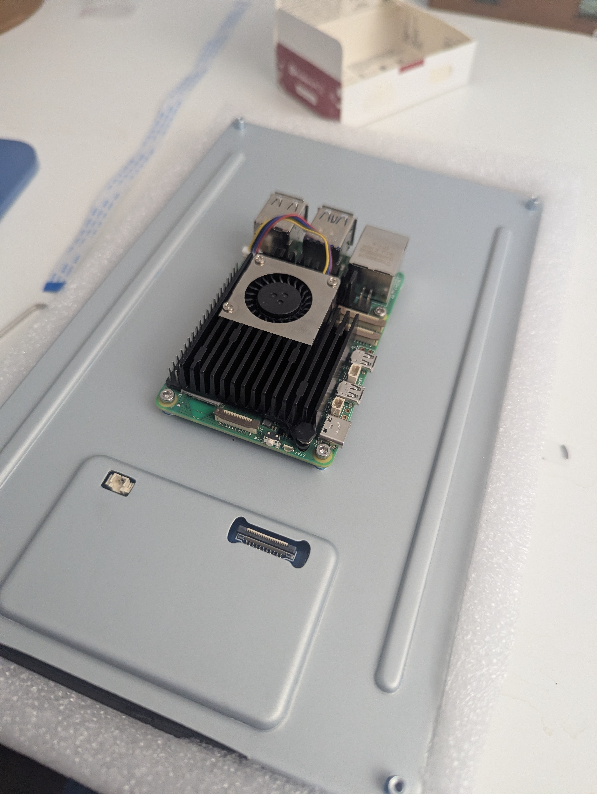
\</p>

Use the display power cable and 22-pin connector that came with the display to connect it to the Raspberry Pi at the CAM1 DSI connector. Then, connect the 250mm CSI cable to the CAM0 connector. This will be plugged into the camera later.

\<p align="center">
&#x20; \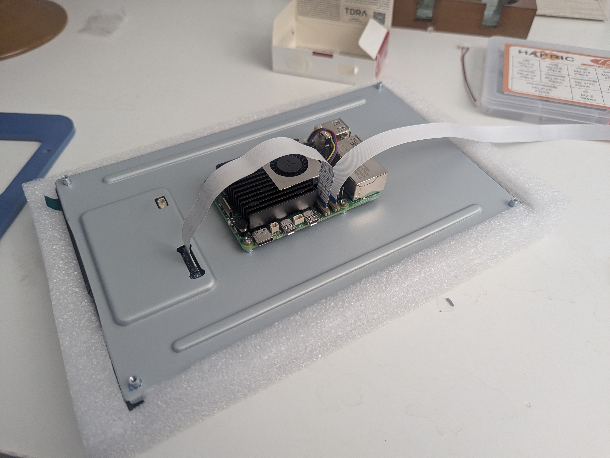
&#x20; \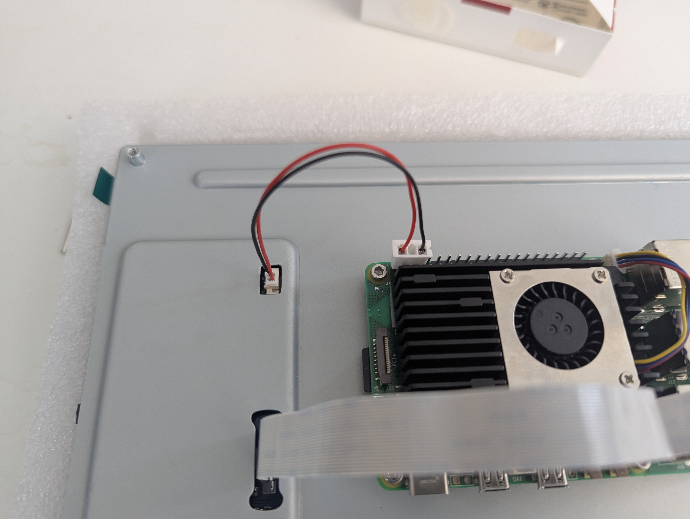
\</p>

Slide the Pi and display into the enclosure, then use two 10mm M2.5 screws to secure the display to the top of the enclosure and two 6mm M2.5 screws to secure the bottom of the enclosure. Depending on your 3D printer's tolerances, you may need to drill out the display's screw holes and use washers to secure the connection.

\<p align="center">
&#x20; \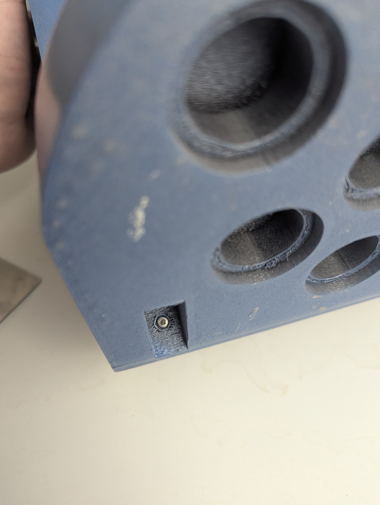
&#x20; \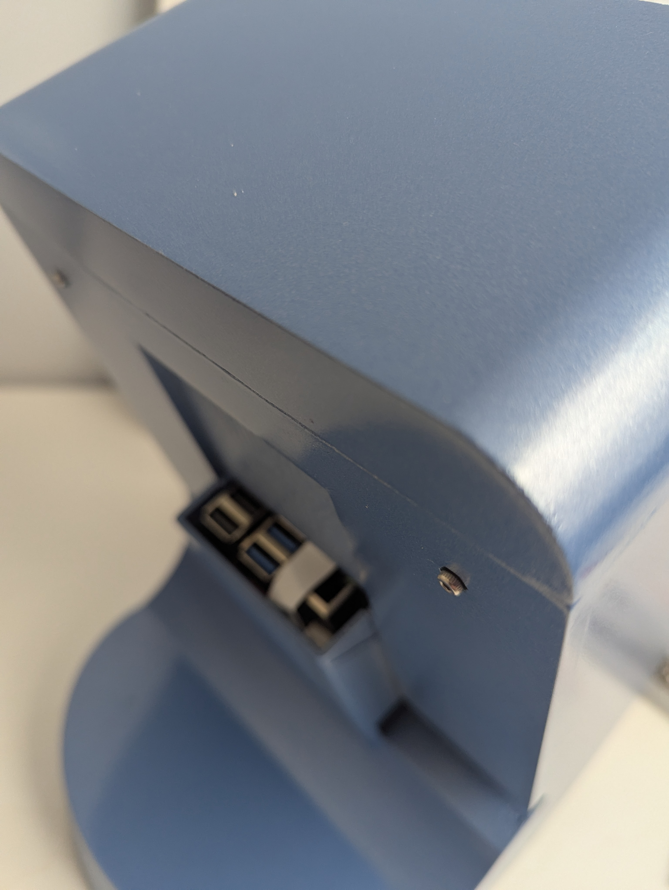
\</p>

Cut two pieces of semi-reflective acrylic and one piece of fully reflective acrylic to 162x110mm. Slide the semi-reflective pieces into the top and middle slots of the display, and the fully reflective piece into the bottom slot.

\<p align="center">
&#x20; \
\</p>

Thread the 250mm CSI cable through the top slot of the camera holder and connect the camera. Then, place the camera into the holder.

\<p align="center">
&#x20; \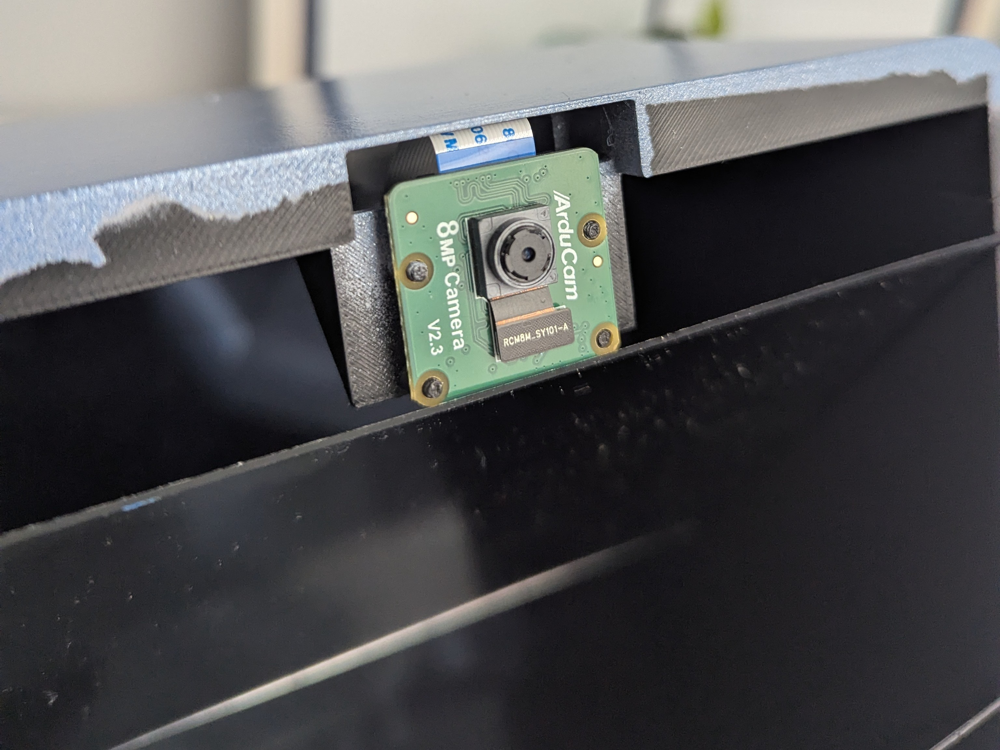
\</p>

Glue four M2.5 nuts into their corresponding holes on the front of the display. Then, use four 6mm M2.5 screws to attach the display lid to the front.

\<p align="center">
&#x20; \
\</p>

# Setting up the USB drive

MultiPlaneDisplay stores your images, 3D models, and calibration files on a USB drive. This drive must be set up before running the system.

Make sure the drive is formatted using either the exFAT or FAT32 file system and is named "mdisplaydrive," as shown below.

\<p align="center">
&#x20; \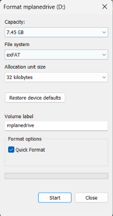
\</p>

Create an "images" folder and a "models" folder in the drive's root directory. Image files can be placed directly into the images folder. 3D models must be placed in a unique folder within the models folder containing the .obj, .mtl, and .jpg texture files.

\<p align="center">
&#x20; \
\</p>

Make sure to plug the USB drive into the blue USB 3.0 port on the Raspberry Pi before running the display.

# Installation

Make sure you are in your user directory (`/home/username`).

```bash
git clone https://github.com/aidanmontag13/MultiPlaneDisplay3D.git
cd MultiPlaneDisplay3D
bash setup.sh
```

# Calibration

Before use, the camera intrinsics and display offset must be calibrated to ensure proper display functionality. This is accomplished in two stages.

## Stage 1: Intrinsic calibration

For intrinsic calibration, you must print a 9x6 checkerboard like the one at this link. Use a clipboard or book to keep the paper flat.

\<p align="center">
&#x20; \
\</p>

After starting your display, a camera feed will appear. Hold the checkerboard in front of the camera and slowly move it across the frame until it fills the entire area.

A visualizer will show where your checkerboard detections are, along with how densely they are distributed. Make sure to hold the board at various angles and distances so multiple depths can be calibrated. Once every square in the visualizer turns green, calibration is complete.

\<p align="center">
&#x20; \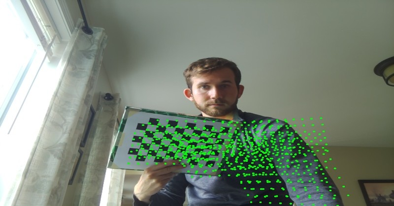
\</p>

## Stage 2: Offset calibration

Offset calibration is necessary to estimate the distance from the camera to the center of the display. For this process, you don't need a calibration target, just your right eye!

During this step, red, green, and blue crosses are projected onto each of the three displays. Close your left eye while keeping your right eye open, and align yourself with the three crosses so that they all appear to overlap. When properly aligned, the crosses should appear white.

Hold this position. After a few seconds, a ring will begin to draw around the cross. Once the ring is fully drawn, calibration is complete.

The offset target will initially appear as shown below.

\<p align="center">   \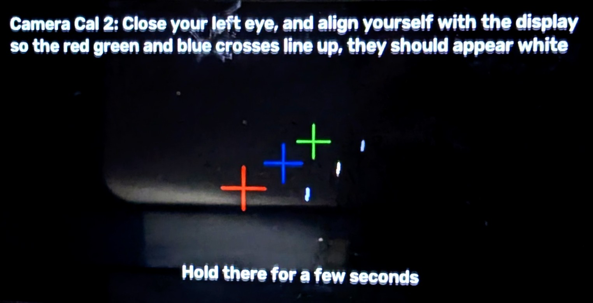 \</p>

Move your head until the crosses appear aligned, as shown below.

\<p align="center">
&#x20; \
\</p>

## Recalibrating

If you are unsatisfied with your calibration, you can restart the process by turning off the Pi, removing the USB drive, and deleting the "camera_intrinsic_calibration.txt" and "camera_offset_calibration.txt" files. Once you plug the USB drive back in and restart the Pi, the calibration prompt will appear.
